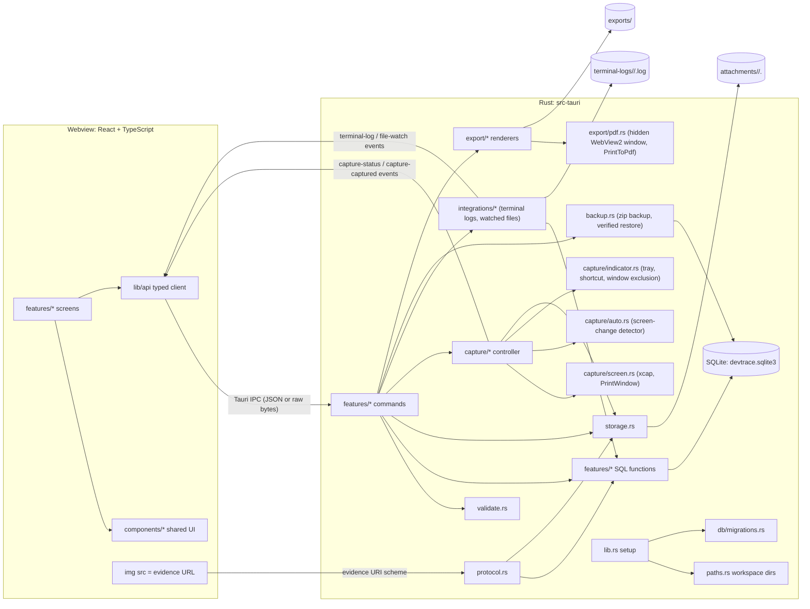
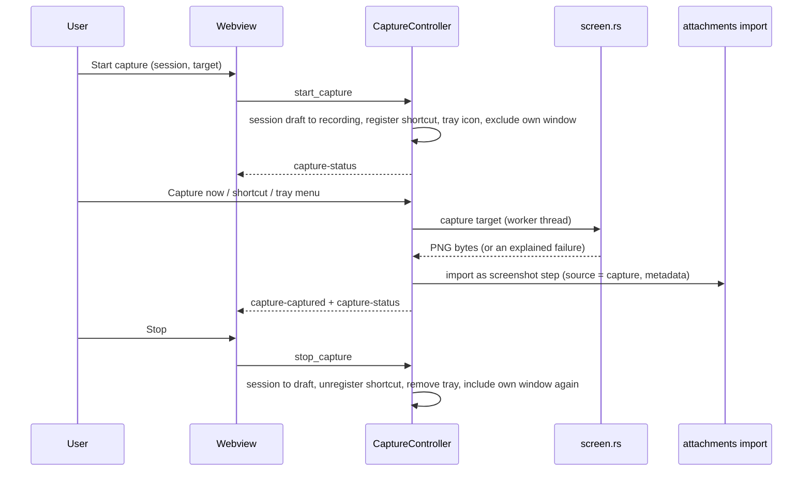

# Architecture

This document describes the implementation as of **Milestone 9**. Update it with every milestone.

## Overview

DevTrace is a [Tauri 2](https://tauri.app) desktop application: a React + TypeScript interface rendered by the operating system's webview (WebView2 on Windows) and a Rust backend that owns all data and file access. There is no server and no network dependency.



## Process and startup

1. `main.rs` calls `devtrace_lib::run()`.
2. The builder registers the `evidence` URI scheme, the global-shortcut plugin (no shortcut is registered until a capture starts), the dialog plugin (used from Rust only, to let the user pick a file to watch or a backup, and to save a backup) and the command handlers. `setup` resolves the workspace directory (`paths.rs`; `DEVTRACE_DATA_DIR` overrides the default app data directory), installs the crash-report hook (`crash.rs`), creates managed folders, opens SQLite, runs migrations (`db/`), returns sessions left recording by a crash to draft, and creates the `CaptureController` with the saved capture shortcut; `TerminalLogs` and `FileWatches` hold the active integrations and `BackupState` the backup chosen for restoring. On exit, an active capture is ended (`capture::shutdown`) and every terminal log and file watch is stopped.
3. If the database cannot be opened, the app still starts in a **degraded mode**: `AppState::unavailable` records the error, every data command returns `storage_unavailable` (the `evidence` scheme answers 503), and the UI shows a full-window explanation (`SystemGate`). Release builds have no console where a panic would be visible.
4. The main window is created **hidden** (`tauri.conf.json`). `public/boot-theme.js` applies the cached theme before React renders; `main.tsx` shows the window after the first painted frame. A Rust fallback shows the window after 4 seconds if the frontend never does.

## Frontend

```
src/
  main.tsx            Entry: renders <App/>, reveals the window, blocks stray file drops
  app/                Providers (settings/theme, app info, live capture state), routing, system gate, error
                      boundary, not-found page
  layout/             AppShell (grid, shortcuts, announcements), Sidebar (incl. live capture status), WorkspaceSelector, Page, Section
  components/         Shared UI library (see below)
  features/           One folder per screen
    playbooks/        PlaybooksPage (list, New Playbook), PlaybookPage (document editor and properties),
                      PlaybookHistoryPage (versions, read view, comparison, restore, duplicate),
                      PlaybookReadView (read-only document), PlaybookImage (screenshot with numbered
                      highlights), NewPlaybookDialog, ExportDialog (version, format, result with Show in
                      folder), playbookModel.ts (draft, provenance, ordering and export-version helpers),
                      historyModel.ts (version list, canonical text for comparison)
    capture/          CapturePage (setup incl. the opt-in automatic capture switch, or the live session while
                      recording), CaptureControls (status, Capture now, Auto capture toggle, pause/resume,
                      stop), CaptureAlerts, shortcuts.ts
    sessions/         SessionsPage (list), SessionPage (workspace, also used by Capture), SessionFormDialog,
                      EventFormDialog, EvidencePane (viewer, annotate, redact), SessionInspector, ReviewPanel
                      (step decision, order, history; session review), SessionIntegrations (terminal log and
                      watched files in the Session tab), review.ts, useImageImport, eventTypes
    changes/          ChangeHistoryPage (list, filters, inspector with review, verification, edit, delete),
                      ChangeFormDialog (record or edit a declared change)
    settings/         SettingsPage incl. IntegrationList (what each integration does and where it is started) and
                      BackupSettings (back up, restore with confirmation, notice after the reload)
  lib/
    api/              The only IPC boundary: typed commands, raw image upload, evidenceUrl(), ApiError
    events.ts         Backend events (capture-status, capture-captured, terminal-log, file-watch) plus in-app
                      publication of command results
    availability.ts   What this build can and cannot do (drives "unavailable" explanations)
    status.ts         Status vocabulary: label + tone + icon + description for every enum
    hooks.ts          useResource, useMediaQuery, useHotkeys, useAutosave
    format.ts, validation.ts, diff.ts, platform.ts, cx.ts
  styles/
    tokens.css        All design tokens (light and dark)
    base.css          Element defaults, focus rings, reduced motion
  test/               Vitest setup and an in-memory backend for integration tests
```

### Design system

- **Tokens** (`src/styles/tokens.css`) are the single source of truth for color, typography, spacing, radius, sizing, elevation, motion and layering. Theme switching only changes the `data-theme` attribute on `<html>`.
- **CSS Modules** style each component and screen, using variables only. `scripts/check-tokens.mjs` (part of `npm run lint`) fails the build when literal colors or radii appear outside `tokens.css`.
- **Shared components**: `Button`/`IconButton`, `TextField`, `TextArea`, `Select`, `SearchField`, `Switch`, `SegmentedControl`, `Tabs`, `DataTable`, `StatusBadge`, `EmptyState`, `Notice`, `Dialog`/`ConfirmDialog`, `Menu`, `Tooltip`, `Toast`, `Inspector`/`PropertyList` (optional custom header, e.g. tabs), `Timeline` (detail text, Enter/double-click activation), `ScreenshotViewer` (fit/zoom, navigation, explicit state when an image cannot be loaded), `DiffView`, `Kbd`, `Spinner`, `Icon`.
- A development-only **component gallery** (`#/dev/components`, compiled out of production builds) renders every component with labeled sample content for visual verification.

### Session workspace (`/sessions/:sessionId`)

The page remounts per session id so no state leaks between sessions. Layout: toolbar (breadcrumb, **Add** menu, **Complete**/**Reopen**, more actions), a metadata strip, then three panes:

| Pane | Content |
|---|---|
| Steps (timeline) | Ordered events with time, type and image count; arrow keys, Enter/double-click to edit; empty state with actions; a hint that Ctrl+V and drag and drop add screenshots |
| Evidence | The selected screenshot (navigation across all screenshots of the session) or a reading view of a text step, including a command block that is copied, never run |
| Inspector | **Step** tab: provenance, capture facts for captured screenshots (taken with, target, size), terminal facts for recorded commands and output (format, masking, output), watched-file facts for recorded file changes, **review** (Approve / Reject / Exclude / Pending with an optional comment, Move up/down, the step's decision history), attached screenshots with SHA-256 and remove actions, and annotations (numbered highlight boxes with labels). **Session** tab: autosaved notes, **integrations** (start/stop a terminal log with the command to run, watched files), **review** progress with Mark reviewed / Reopen review and the session's full audit trail, and session details |

The step list has a review filter (all, pending, approved, rejected, excluded); decided steps show their status and rejected/excluded steps are dimmed. With a step focused, `A`/`R`/`X`/`P` record a decision and `Alt+↑/↓` move it. The viewer's **Redact** mode collects marked rectangles locally and applies them only after a confirmation dialog; the evidence URL carries the image's SHA-256, so the redacted image replaces the old one immediately.

Completed sessions are read-only for steps and evidence: controls stay visible but are unavailable with an explanation, and paste/drop explain why nothing was added. Review decisions stay available because they do not change evidence.

### Capture workspace (`/capture`)

Without an active capture, the page sets one up: the destination (a draft session or a new one), the target (displays, then visible windows; Refresh re-lists), whether to also capture automatically when the screen changes (off by default), what DevTrace records, and **Start capture**. While a capture is active, the same route renders the session workspace (`SessionPage` with `variant="capture"`) with the capture controls in the toolbar: a live status (Recording/Paused, elapsed time, count, whether automatic capture is on), **Capture now**, the **Auto capture** toggle (`aria-pressed`), Pause/Resume and **Stop**, plus alerts for a shortcut that could not be registered or a background screenshot that failed. Screenshots triggered by the button, the shortcut or the tray are selected as they arrive; automatic screenshots are only added to the list, so they never pull the user away from the step they are working on.

`CaptureProvider` keeps the live `CaptureStatus` for the whole app: it loads it once, listens to `capture-status`, and receives command results through the in-app channel in `lib/events.ts` (D-040).

### Patterns

- **Unavailable features** use `Button`'s `disabledReason`: the control is `aria-disabled` (still focusable), blocks activation, and explains itself in a tooltip and an accessible description. Reasons come from `lib/availability.ts` or the current state (for example a completed session).
- **Data loading** uses `useResource(fetcher)`: loading, error and data states with a stale-while-reloading `reload()`. Pages render explicit error notices with a Retry action.
- **Forms** validate on the client with the same rules as Rust (`lib/validation.ts` mirrors `validate.rs`, including preformatted text normalization), keep user input on failure, and map backend field errors (`ApiError.field`) to the matching input. Multi-line fields submit with Ctrl+Enter.
- **Autosave** (`useAutosave`) saves after a short pause, on blur and on unmount; saves never overlap; the indicator shows "Saving…" whenever the text differs from what was last stored and keeps an error (with Retry) until a save succeeds. Both inspector tabs stay mounted so switching tabs never discards unsaved notes.
- **Image input** (`useImageImport`): the native file chooser (`<input type=file>`), paste events outside text fields and dialogs, and HTML5 drag and drop. Files are read in the webview and sent as bytes, one at a time; errors are shown per file.
- **Routing** uses React Router's `HashRouter`, so back/forward work without server-side routing. Selection and filters that should survive navigation live in the URL (`/projects/:projectId`, `/sessions/:sessionId`, `/sessions?project=…`, `?new=1` to open a create dialog from another page).
- **Accessibility**: landmarks (`nav`, `main`, `aside`), a skip link, route change announcements, visible `:focus-visible` rings, roving focus in tabs/tables/menus/timelines, native `<dialog>` (focus trap, inert background, Escape), native `<select>`, status shown with icon + text, reduced-motion support, and responsive collapse of the sidebar below 1100 px.

## Backend

```
src-tauri/src/
  lib.rs              Builder, plugins, evidence scheme, setup (incl. capture recovery), commands, exit hook
  state.rs            AppState: Mutex<Option<Connection>>, paths, storage error; replace_database for restores
  paths.rs            Workspace layout and DEVTRACE_DATA_DIR override
  error.rs            AppError -> { kind, message, field } across IPC
  crash.rs            Panic hook writing local crash reports to <workspace>/logs
  dialogs.rs          System open/save dialogs shown from Rust, with test hooks (DEVTRACE_E2E_*)
  backup.rs           Workspace backup (zip + manifest) and verified, reversible restore; commands
  clock.rs            UUIDv7 identifiers and fixed-width RFC 3339 UTC timestamps
  validate.rs         Authoritative text, preformatted-text and identifier validation
  macros.rs           text_enum!: enums that round-trip through serde and SQLite
  storage.rs          Evidence files: content sniffing, limits, SHA-256, atomic writes, contained paths, removal
  protocol.rs         `evidence` URI scheme handler
  capture/
    mod.rs            CaptureController (state machine), start/pause/resume/stop, take_screenshot, the automatic
                      capture sampler thread, commands
    auto.rs           ChangeDetector: decides when a sampled screen changed and settled (pure, unit-tested)
    screen.rs         Target listing and capture (xcap), small grayscale samples, black-image check, PNG encoding
    win_window.rs     Windows: PrintWindow into a DIB, 1:1 crop to the visible frame
    indicator.rs      Tray icon and menu, global shortcut registration, main-window capture exclusion
  integrations/
    mod.rs            Integration catalog (list_integrations)
    tail.rs           TailReader: reads what was appended to a file (UTF-8, UTF-8 BOM, UTF-16 LE/BE)
    transcript.rs     Log format adapters (PowerShell transcript, plain log) and secret masking
    terminal.rs       Terminal logs: log file per session, reader thread, steps for commands and output, commands
    file_watch.rs     Watched files: Rust-side file dialog, polling, line diff, step + observed change, commands
  export/
    mod.rs            Export orchestration: prepare, unique names, atomic writes, commands (export, reveal)
    document.rs       ExportDocument: one playbook version (working copy or revision snapshot) with notices
                      and provenance
    images.rs         Screenshots for exports: read copies, draw numbered highlights on a copy
    markdown.rs       Markdown renderer and escaping
    html.rs           Self-contained HTML renderer (embedded images, strict CSP, print styles)
    pdf.rs            Windows: print the HTML with WebView2 PrintToPdf in a hidden window
  db/
    mod.rs            Connection settings (WAL, foreign keys, busy timeout)
    migrations.rs     Ordered migrations, backups, newer-version refusal
    sql/0001_foundation.sql, sql/0002_events_attachments.sql, sql/0003_capture_review.sql,
    sql/0004_playbook_authoring.sql, sql/0005_version_history.sql, sql/0006_change_tracking.sql
  features/
    settings.rs       ApplicationSettings (key/JSON rows), incl. the capture shortcut
    projects.rs       Project CRUD
    sessions.rs       Session CRUD, notes, complete/reopen, capture status transitions and recovery, safe delete
    events.rs         Event list/create/update/delete (with metadata); `record` for steps added by integrations
                      (log, change and command events from the terminal or a watched file)
    attachments.rs    Raw-bytes image import (shared by capture), annotations, removal, lookup for the evidence scheme
    review.rs         Review decisions and audit trail, reordering, session review state, redaction (decode, burn in, replace file,
                      redact playbook copies)
    playbooks.rs      Playbook list/detail, generation from approved steps (evidence copies), save, status and revisions, delete,
                      VersionSnapshot (the stored shape of revisions and restore points)
    revisions.rs      Version history: read revisions and restore points, restore (with restore points), out of date,
                      duplicate (with evidence copies)
    playbook_content.rs  The playbook document model, validation and generation of steps from events
    changes.rs        Change records: list, declare, edit (declared and pending only), review (approve / reject /
                      reset with a comment), verify (note required), delete, record observed changes
    overview.rs       Aggregated counts and recent items
    system.rs         App info and "reveal workspace folder"
```

Each feature module contains its domain types, plain functions that take a `rusqlite::Connection` (unit-testable without Tauri), and thin `#[tauri::command] async fn` wrappers. Commands are `async` so database and file work never runs on the UI thread. Multi-statement changes run in one transaction.

### Evidence pipeline

**Import** (`import_image`): the webview sends the image as the raw IPC request body; metadata travels in headers (`x-session-id`, optional `x-event-id`, `x-source` = `file` | `clipboard`, and percent-encoded `x-title` / `x-file-name`). No file-system path crosses the IPC boundary and the webview has no file-system permission.

1. Validate headers and check that the session (and target event, which must belong to it) can be changed — under the database lock.
2. Inspect the bytes (signature-based type detection for PNG/JPEG/GIF/WebP, ≤ 25 MB, dimensions ≤ 20 000 px read from the header), hash them (SHA-256) and write `attachments/<session>/<id>.<ext>` atomically — **without** holding the database lock.
3. Re-check and record the event (for a new screenshot step) and the attachment row in one transaction. If this fails, the written file (and an empty session folder) is removed.

**Serving** (`protocol.rs`): images are loaded from `evidence://localhost/<attachment-id>` (`http://evidence.localhost/<id>` on Windows; built by `convertFileSrc(id, "evidence")`). The handler accepts only GET/HEAD and a valid id, looks the id up in the database, resolves the stored relative path through `storage::resolve_contained` (plain names only, no `..`, no absolute paths, no Windows device names), reads the file on a worker thread, and responds with the stored media type (only the four image types are ever served), `X-Content-Type-Options: nosniff` and `Cache-Control: no-store` so evidence is not copied into the webview cache. Unknown ids answer 404, invalid ids 400, storage failures 503.

**Deletion**: rows are deleted in a transaction while holding the lock; files are removed afterwards. Results report removed, already-missing and failed files, and the UI tells the user when files could not be removed. Unknown files are never deleted automatically.

**Redaction** (`review.rs`): with the session checked as open, the original file is read and decoded without holding the database lock (allocation limits, first frame of animations), the regions are filled with opaque black, and the result is written atomically as a new PNG. One transaction then verifies the attachment still points at the file that was read, switches the row to the new file (SHA-256, size, media type, `redacted_at`) and appends a `redact` decision; on failure the new file is removed. Only then is the original deleted, and a failure to delete it is reported to the user.

### Capture pipeline



- **State**: `CaptureController` holds the live state (target, session, start time, count, last error, registered shortcut) behind a mutex; start/pause/resume/stop are serialized by an async lock so database and OS side effects never interleave. The pure state machine (`Inner`) is unit-tested without a window.
- **Targets** are listed with `xcap` (displays in system order, then visible windows front to back) and resolved again by id when capturing, so a stale or forged id cannot be captured; a window id must still belong to the same application.
- **Capturing** runs on a blocking worker: displays through GDI (`xcap`), windows through `PrintWindow(PW_RENDERFULLCONTENT)` into a 32-bit DIB cropped 1:1 to the DWM frame (`win_window.rs`). The image is made opaque, refused if completely black, encoded as PNG (fast compression) and stored through the same import as user images. Failures set `last_error`, which the capture workspace shows; button failures also show a notification.
- **Visibility** (`indicator.rs`): a tray icon with a runtime-drawn status dot and a menu (Capture now, Pause/Resume, Stop, Show DevTrace), created and removed on the main thread; the global shortcut is registered only while recording; the main window uses `set_content_protected` (`WDA_EXCLUDEFROMCAPTURE`) only while recording.
- **Recovery**: sessions left `recording`/`paused` are returned to draft at startup; `RunEvent::Exit` ends an active capture.

### Playbook authoring

Generation reads the session, its events and the stored paths of approved evidence under the database lock, copies the files into `playbook-assets/<playbook_id>/` without the lock, then records the playbook, its asset rows, the session link and the generated document in one transaction (copies are removed if that fails). The editor keeps a local draft (metadata plus document) and autosaves it through `save_playbook`, which validates the whole document in Rust and deletes evidence copies no longer referenced by the draft or any revision. Status changes first wait for pending saves; the editor remounts after a status change so it always starts from the stored document. The `evidence` scheme looks ids up in `attachments` first and then in `playbook_assets`.

### Export pipeline

```mermaid
sequenceDiagram
  participant W as Webview (ExportDialog)
  participant E as export/mod.rs
  participant D as document.rs + images.rs
  participant R as markdown.rs / html.rs
  participant P as pdf.rs (hidden window)
  W->>W: save pending draft changes
  W->>E: export_playbook(id, format, revisionId?)
  E->>D: load version under the DB lock; read and prepare screenshots without it
  E->>R: render
  alt Markdown
    R-->>E: .md text; images written into a hidden staging folder, renamed when complete
  else HTML
    R-->>E: self-contained HTML, written atomically
  else PDF
    E->>P: temporary HTML file, PrintToPdf to a temporary file (one at a time, 120 s timeout)
    P-->>E: %PDF file renamed into place; window destroyed; temporary files removed
  end
  E-->>W: ExportResult (file, relative path, size, images, missing images, version)
  W->>E: reveal_export(relativePath) on Show in folder
```

- **Versions**: without a revision id, a published playbook exports its newest revision snapshot and an unpublished one its saved working copy; revision snapshots carry their own metadata and content, and their evidence copies are kept by the asset cleanup rule.
- **Content**: sections in editor order (warnings before steps), empty sections omitted, notices for unpublished, superseded and out-of-date versions, per-step provenance, highlight boxes drawn on copies with numbered captions, redaction state, placeholders for missing files, and a footer with app version, time and playbook id.
- **Isolation**: the PDF window loads a local file, which Tauri treats as a remote origin (no command access; the capability only covers the `main` window), and the document's CSP forbids scripts and remote loads. Its print settings take the paper size from the Windows region and print a header (date, title) and page numbers without the file address.

### Version history

`revisions.rs` reads revision and restore-point snapshots (`VersionSnapshot`: metadata plus content, the same JSON stored in `playbook_revisions` and `playbook_restore_points`). **Restore** checks the status (not in review), refuses a no-op, validates the stored content against the playbook's evidence copies, writes a restore point of the current working copy unless it equals the newest revision, and replaces the working copy in one transaction (status `draft`, `restored_from_revision`). **Duplicate** reads the source under the database lock, copies the referenced evidence files to new ids without the lock, then records the new playbook, asset rows (copied metadata), session links and origin in one transaction (files are removed if that fails). Asset cleanup on save keeps every copy referenced by the draft, a revision or a restore point.

The history page (`/playbooks/:id/history`) keeps its selection in the URL (`version`, `view`, `from`, `to`). Versions other than the working copy are fetched on demand. Comparison renders both versions to canonical text (`historyModel.versionText`) and uses the shared line diff (`lib/diff.ts`) and `DiffView`, which can collapse unchanged runs (`collapseUnchanged`).

### Automatic capture

Opt-in per capture (the setup switch, or the **Auto capture** toggle while recording; off by default). Each capture start increments a generation; when automatic capture is on, a sampler thread for that generation wakes about once a second and asks the controller whether to sample (`sampling(generation)`: only while recording with automatic capture on; the thread ends when the capture ends or a new one starts). It captures the target like a screenshot but keeps only a 96×64 grayscale sample in memory (`screen::capture_sample`), and feeds it to `auto::ChangeDetector`:

- a **change** is more than 2 % of sample points differing (by more than 16 brightness levels) from the sample at the last screenshot; small changes such as a blinking cursor or typing in a field are ignored;
- the screen must have **settled**: two consecutive samples with less than 0.4 % motion;
- screenshots are at least **3 s apart** and at most **12 per minute**.

When the detector fires, the sampler calls the same `take_screenshot` as Capture now with trigger `auto` (stored in the screenshot's metadata and shown as "Automatic capture"). Pausing or switching it off resets the detector, so nothing is sampled while paused and a resumed capture starts from a fresh baseline. Three failures in a row switch automatic capture off and set `last_error`, which the capture workspace shows. There are no keyboard, mouse or accessibility hooks: the detector only sees pixels of the chosen target.

### Integrations

`integrations/` holds opt-in sources of recorded steps, each started per session from the Session tab, visible while active (status line, step counts, last error) and stoppable with one click. They stop when the user stops them, when the session is completed or deleted, and when DevTrace exits. Recorded steps are normal session events (`pending` review) with `source = terminal` or `file_watch`. `list_integrations` describes each one for Settings.

- **Terminal log** (`terminal.rs`): `start_terminal_log(sessionId, format)` creates an empty file `terminal-logs/<session>/<log-id>.log` and returns its absolute path. The UI shows how to make the user's own terminal write to it (`Start-Transcript -Path "<path>" -Append` for PowerShell; the path for PuTTY or other tools); DevTrace never runs anything. A reader thread polls the file every 500 ms through `TailReader` (appended bytes only; BOM detection for UTF-8 and UTF-16, partial lines buffered) and feeds lines to the format adapter (`TranscriptParser`). The PowerShell adapter skips the asterisk-framed header/footer blocks and pairs each prompt line (`PS C:\path> command`) with the output that follows; the plain adapter groups output between quiet periods. Buffered entries are recorded after 2.5 s without new lines or when logging stops. Commands become `command` steps (the command as code, the output in metadata), other output becomes `log` steps. `mask_secrets` replaces values after secret-looking keys (`password=`, `token:`, `-Password …`, `Bearer …`) with `********` before anything is stored. Status is broadcast as `terminal-log`.
- **Watched file** (`file_watch.rs`): `watch_config_file(sessionId)` shows the system file dialog from Rust (`tauri-plugin-dialog`; the webview cannot supply a path), accepts text files up to 1 MB (UTF-8 or UTF-16 with BOM), and polls size and modification time every second. A change is read after it settled for one more check; if the text differs, one transaction records a `change` step (changed lines as `+`/`-` text, counts in metadata) and an **observed** change record with the full before and after text, linked to the step. Missing or unreadable files are reported and checked again. At most 5 files per session. Status is broadcast as `file-watch`. The end-to-end test sets `DEVTRACE_E2E_PICK_FILE` to bypass the dialog (D-064).

### Change tracking

`changes.rs` keeps evidence level, review and verification separate: `assertion` is `observed` (recorded by DevTrace from a watched file), `declared` (stated by a person through **Record Change**) or `verified` (confirmed with a required note on how); `approval_state` is `pending`, `approved` or `rejected` with reviewer, time and comment. Declared changes can be edited only while declared and pending; observed values are never editable; a rejected change cannot be verified and a verified change cannot be rejected. Change History lists, filters and sorts the records and shows the values as a diff, the source, and links to the session and step.

### Backup and restore

```mermaid
sequenceDiagram
  participant W as Webview (Settings)
  participant B as backup.rs
  participant S as AppState (DB lock)
  W->>B: create_backup
  B->>B: save dialog (Rust)
  B->>S: VACUUM INTO a temporary copy (under the lock)
  B->>B: zip database copy + attachments, playbook-assets, terminal-logs + manifest (SHA-256) to name.partial, rename
  W->>B: choose_backup
  B->>B: open dialog; validate manifest, versions, entry names and sizes; keep the path, return a token
  W->>B: restore_backup(token) after confirmation
  B->>B: stop terminal logs and watched files; extract to backups/restore-staging, verify checksums and integrity
  B->>S: replace_database: close, move current data to backups/before-restore, move staged data in, reopen and migrate (undo on failure)
  B-->>W: RestoreResult; the webview reloads
```

`backup.rs` keeps the pure parts (`snapshot`, `write_archive`, `read_manifest`, `extract`, `swap_in` with an undoable `Swap`, `restore`) testable without Tauri; the commands add the dialogs, the capture check, a single-operation guard and the integration shutdown. The webview never sees the chosen backup path for restoring, only a token.

### Reliability

- **Permissions**: `build.rs` declares every command in the app manifest; the `main-window` capability allows exactly those for `main` (D-068). `scripts/check-permissions.mjs` keeps `lib.rs`, `build.rs` and the capability in sync.
- **Errors**: commands return `AppError` (validation, not found, conflict, storage, internal) and never panic on user input (no `unwrap`/`expect` outside tests and the builder). A panic hook writes local crash reports (D-069); a React error boundary replaces a crashed interface with an explanation and Reload. Background workers (capture sampler, terminal reader, file watcher) report failures through their status instead of failing silently.
- **Accessibility**: automated axe-core audits run in the end-to-end test on every photographed screen in both themes (D-071).

## Security and privacy

- **Capabilities** (`src-tauri/capabilities/default.json`) grant the main window only `core:default`, showing, focusing and theming the window, and an explicit allow-list of the application's own commands (generated from `build.rs`, D-068). No file system, shell, dialog, HTTP or global-shortcut plugin permission is exposed; the capture shortcut, tray and file dialogs are driven from Rust. Other windows get no command access.
- **Capture** happens only during a capture the user started, only of the chosen target, and only when the user asks (button, shortcut, tray) or — if switched on for that capture — after the target visibly changed (in-memory grayscale samples, discarded). No keyboard, mouse or accessibility hooks exist; keystrokes, clicks and typed text are never recorded. The state is always visible (sidebar, capture bar, tray), and DevTrace hides its own window from screen capture only while recording.
- **Integrations** are opt-in per session, visible while active, and stop with the session or on exit. The terminal reader only reads the log file DevTrace created in the workspace; the file watcher only reads files the user picked in the system dialog (text, ≤ 1 MB). DevTrace never runs commands or attaches to processes. Secret-looking values are masked before terminal text is stored.
- **Files**: the webview never sends file paths. Images enter as bytes and leave through the id-based `evidence` scheme; the backend validates content, limits size, and confines every path to the workspace attachments folder. The only paths the webview receives are informational: the terminal log file to write to and the watched files' locations.
- **Native drag and drop** is disabled on the window (`dragDropEnabled: false`) so drops reach the page as HTML5 events with file contents only; a global guard prevents the webview from navigating to a file dropped outside a drop zone.
- **Clipboard**: DevTrace reads images only from paste events the user triggers (Ctrl+V) in a session; it never reads the clipboard on its own. Copying a command to the clipboard happens only when the user clicks Copy.
- **Commands** recorded in sessions are stored as text and never executed.
- **Opening the workspace folder** is a Rust command that can only reveal the workspace path; **Show in folder** for exports only reveals existing files inside the exports folder.
- **Exports** are written only on request into `exports/`. Exported HTML has no scripts, embeds its images and declares a CSP that blocks all remote content; the hidden PDF window has no command access.
- **Content Security Policy** restricts scripts, styles and connections to the app itself and Tauri IPC; images may come from the app, `data:`/`blob:` and the `evidence` scheme. The UI cannot contact external servers. Inline scripts are not allowed.
- **No telemetry** of any kind. All data stays in the workspace directory; backups are written only where the user chooses, and crash reports stay in `logs/`.

## Testing

| Layer | Tooling | What it covers |
|---|---|---|
| Rust | `cargo test` (in-memory and temporary SQLite, temporary folders) | Migrations incl. upgrade from a real v1 file with backup, structural constraints, persistence, validation (incl. preformatted text), session/event CRUD, completion rules and read-only enforcement, capture state machine and session capture transitions, crash recovery, capture metadata, annotations, PNG encoding and black-image detection, window frame cropping, tray tooltip/icon, image inspection (spoofed and damaged content, limits), SHA-256, contained paths, atomic writes, import rollback, header parsing, file cleanup on delete, review and redaction, playbook generation and revisions, export (escaping, section order, provenance and notices, highlight drawing, unique names, atomic folders, revision vs draft, missing evidence, reveal path validation), version history (restore with restore points, evidence retention, out-of-date rules, duplication), automatic capture (change detector thresholds, settling, spacing and per-minute limit, reset), integrations (tail reading with BOMs and partial lines, PowerShell and plain log parsing, secret masking, line diff, text file limits), change records (declare/edit/review/verify rules, observed records), recorded events (shortening, joining an outer transaction), backups (contents, restore with kept previous data, damaged/tampered/escaping/unlisted/newer archives, undone swaps), crash report text. An ignored test (`cargo test real_capture -- --ignored --nocapture`) captures every real target |
| Frontend | Vitest + Testing Library + jsdom | Components, formatting, validation, autosave hook, IPC error handling, capture details, and app-level flows through the real API client against an in-memory backend (sessions: create, filter, steps, commands, paste, attach, reject, notes, complete/reopen, delete; capture: setup, start, Capture now, pause/resume, stop, blocked completion, start failures, shortcut setting, annotations, automatic capture switch and toggle; review; playbooks; export dialog and version options; version history; Change History record/edit/approve/verify/delete and observed records; terminal log and watched files; backup and restore; error boundary) |
| Design system and permissions | `scripts/check-tokens.mjs`, `scripts/check-permissions.mjs` | No literal colors/radii outside tokens; registered commands = app manifest = main-window capability |
| End to end | `scripts/e2e-smoke.mjs` (playwright-core over WebView2 DevTools protocol; Win32 helpers in `scripts/e2e-win32.ps1`) | The real built app with an isolated workspace: navigation, honest unavailable states, themes, project CRUD, the full session lifecycle, and capture — target list, start/pause/resume/stop, window exclusion and tray window checked through Win32, a real window capture decoded and checked pixel by pixel (size, content, edges), annotations, explained display-capture failure where the desktop is not shown (full display checks and the shortcut with `--interactive`), crash recovery across a killed process — review, playbook generation and publishing, Markdown/HTML/PDF exports checked on disk (the PDF opened with the Windows PDF renderer, page 1 saved as a preview), version history, automatic capture of a window that changes color (and nothing while paused or switched off), a real PowerShell transcript and prompt lines recorded with masking, a watched file change, observed and declared changes approved and verified, plugin commands refused to the webview, a workspace backup saved and restored after later changes (replaced data kept), an axe-core audit (WCAG 2.1 A/AA) of every photographed screen in both themes, zero unexpected console errors, screenshots. The same suite runs against the release binary and the executable extracted from the MSI (`--binary`) |
