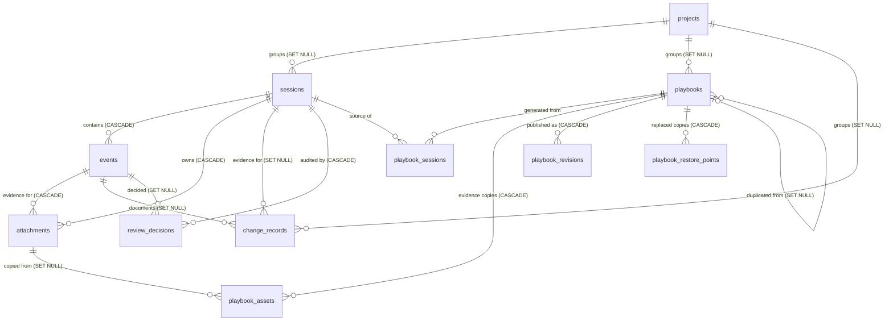

# Data model

DevTrace stores structured data in SQLite and large binary evidence (screenshots) as managed files in the workspace directory. This document describes **schema version 6** (Milestone 8) and the planned evolution of the conceptual model.

## Conventions

| Convention | Rule |
|---|---|
| Identifiers | UUIDv7 strings generated by the backend (`clock::new_id`): stable, unique, roughly time-ordered |
| Timestamps | Fixed-width RFC 3339 UTC with milliseconds, e.g. `2026-10-22T15:33:42.123Z`, generated by the backend (`clock::now`). Lexical order equals chronological order. Displayed in local time by the UI |
| Table types | `STRICT` tables: SQLite rejects values of the wrong storage type |
| Enumerations | Stored as lowercase text; validated by Rust enums (`text_enum!`), the single source of truth. Unknown values read from disk fail loudly instead of being guessed |
| Structural rules | Enforced in SQL: non-empty names/titles, length limits, JSON validity, positive sizes, digest length, foreign keys (`PRAGMA foreign_keys = ON` on every connection) |
| Text input | Validated by `validate.rs`: single-line fields are trimmed and reject line breaks; preformatted fields (commands, notes, descriptions) drop leading blank lines and trailing whitespace but keep indentation; control characters are rejected everywhere; limits count characters, not bytes |
| File paths | Rows store paths **relative** to the workspace's `attachments/` folder (`<session_id>/<attachment_id>.<ext>`), never absolute paths. Paths are never sent to the webview |
| Provenance | Every event and attachment records its `source`, so content recorded by DevTrace (`capture`, `terminal`, `file_watch`) stays distinguishable from content written or supplied by a person (`manual`, `file`, `clipboard`). Recorded events also record how they were recorded (`metadata_json.capture`, `.terminal`, `.fileWatch`) |
| Deletion | Deleting a project never deletes its sessions, playbooks or changes (`ON DELETE SET NULL`). Deleting a session deletes its events and attachments (`CASCADE`) and then their files |

## Conceptual entities

| Entity | Purpose | Status |
|---|---|---|
| ApplicationSettings | Appearance, workspace name, author name, capture shortcut | **Implemented** (`app_settings`) |
| Project | Groups related sessions, playbooks, attachments and changes | **Implemented** (`projects`, full CRUD) |
| Session | One documented technical task | **Implemented** (`sessions`): create, edit, notes, capture (recording/paused), complete/reopen, delete |
| Event | An ordered step of a session: step, note, command, screenshot, terminal output or file change | **Implemented** (`events`): manual create/edit/delete; screenshot events from images and from capture; command, log and change events recorded by integrations (Milestone 8) |
| Attachment | A managed image file linked to a session and event | **Implemented** (`attachments`): import by file, paste, drop or capture; annotations; remove |
| Playbook | A structured, reusable procedure | **Implemented** (`playbooks` with `content_json`): generate from approved steps, create blank, edit, review, publish, delete |
| PlaybookAsset | An evidence copy used by a playbook | **Implemented** (`playbook_assets`, schema v4) |
| ChangeRecord | A configuration/workflow change with explicit evidence level, review and verification | **Implemented** (`change_records`, extended in schema v6): declare, edit, review, verify, delete; observed changes from watched files |
| ReviewDecision | Audit trail of approve / reject / exclude / reset / reorder / redact decisions | **Implemented** (`review_decisions`, schema v3, written since Milestone 4) |
| PlaybookRevision | Immutable snapshot of a playbook's content | **Implemented** (`playbook_revisions`, schema v4): recorded on publish; read, compared and restored in the version history (Milestone 7) |
| PlaybookRestorePoint | A working copy that a restore replaced | **Implemented** (`playbook_restore_points`, schema v5) |

`ChangeRecord` and the `playbook_sessions` link table are additions to the originally listed entities; see [DECISIONS.md](DECISIONS.md) (D-009, D-010).



Traceability: a playbook links to the sessions it was produced from (`playbook_sessions`), a session owns its ordered events, and each event owns its evidence files. Change records can reference the session that evidences them and the step that documents them.

## Schema tables

### `app_settings`

| Column | Type | Notes |
|---|---|---|
| `key` | TEXT PK | e.g. `appearance.theme` |
| `value_json` | TEXT | Must be valid JSON |
| `updated_at` | TEXT | Timestamp |

Keys: `appearance.theme` (`"system"`, `"light"`, `"dark"`), `appearance.reduce_motion` (bool), `appearance.sidebar_collapsed` (bool), `workspace.name` (1–60 chars), `profile.author_name` (0–80 chars), `capture.shortcut` (one of `"Ctrl+Alt+Shift+S"`, `"Ctrl+Shift+F9"`, `"Ctrl+Alt+F10"`, `"Pause"`). Missing, corrupt or unknown rows fall back to defaults so settings can never block startup. Updates are validated first and written in a single transaction.

### `projects`

| Column | Type | Notes |
|---|---|---|
| `id` | TEXT PK | UUIDv7 |
| `name` | TEXT | 1–120 characters; unique, case-insensitive (`ux_projects_name`) |
| `description` | TEXT | Up to 2000 characters, multi-line |
| `created_at`, `updated_at` | TEXT | Timestamps |

### `sessions`

| Column | Type | Notes |
|---|---|---|
| `id` | TEXT PK | |
| `project_id` | TEXT FK → `projects` | Nullable, `ON DELETE SET NULL`; must reference an existing project when set |
| `title` | TEXT | 1–200 characters, single line |
| `application` | TEXT | Application or platform, up to 120 characters |
| `environment` | TEXT | e.g. Production, Lab; up to 60 characters |
| `status` | TEXT | `draft` · `recording` · `paused` · `completed`. `recording` and `paused` are set only by the capture controller; stopping a capture returns the session to `draft`, and sessions left `recording`/`paused` by a crash are returned to `draft` at startup |
| `review_state` | TEXT | `unreviewed` · `in_review` · `reviewed`. Becomes `in_review` on the first review action; `reviewed` only through "Mark reviewed" when no step is pending; back to `in_review` when a step becomes pending again or a new step is added |
| `notes` | TEXT | Up to 20 000 characters, preformatted; autosaved |
| `started_at` | TEXT | Nullable; set when the session is first captured and kept across later captures |
| `ended_at` | TEXT | Nullable; set when the session is completed, cleared when reopened |
| `created_at`, `updated_at` | TEXT | `updated_at` changes with any edit to the session, its events or attachments |

Rules: a session can be completed only when it has at least one event. A completed session is read-only for events and attachments until it is reopened; its notes and details stay editable. Only a draft can be captured into; while it is `recording` or `paused` it cannot be completed, reopened or deleted.

### `events` (schema v2)

| Column | Type | Notes |
|---|---|---|
| `id` | TEXT PK | |
| `session_id` | TEXT FK → `sessions` | `ON DELETE CASCADE` |
| `position` | INTEGER | ≥ 0; timeline order, appended at the end (reordering arrives with review, Milestone 4) |
| `occurred_at` | TEXT | When the step was added |
| `event_type` | TEXT | `step` · `note` · `command` · `screenshot` · `log` (terminal output, v6 vocabulary) · `change` (a watched file changed, v6 vocabulary); immutable after creation. `log` and `change` are only recorded, never written by hand |
| `source` | TEXT | `manual` · `file` · `clipboard` · `capture` · `terminal` (terminal log) · `file_watch` (watched file) |
| `title` | TEXT | 1–200 characters, single line |
| `description` | TEXT | Up to 10 000 characters |
| `notes` | TEXT | Up to 10 000 characters |
| `code` | TEXT | Up to 20 000 characters; required for `command`; the output text for `log`, the changed lines (`+`/`-`) for `change`; empty otherwise. Stored as text and **never executed**. Recorded text that is too long is shortened with a marker instead of being refused |
| `review_status` | TEXT | `pending` · `approved` · `rejected` · `excluded` (Milestone 4). Only `approved` steps may become playbook content |
| `metadata_json` | TEXT | Valid JSON. `{}` for manual and imported events. Captured screenshots: `{"capture": {"trigger": "button" \| "shortcut" \| "tray" \| "auto", "capturedAt": "…", "target": {"kind": "monitor" \| "window", "title", "appName", "width", "height"}}}`. Terminal steps: `{"terminal": {"logId", "format": "powershell" \| "plain", "output" (commands only, up to 20 000 characters), "outputLines", "masked"}}`. File changes: `{"fileWatch": {"watchId", "path", "linesAdded", "linesRemoved"}}` |
| `created_at`, `updated_at` | TEXT | |

Index: `(session_id, position)`. `screenshot` events are created only by adding an image; their `source` is `file`, `clipboard` or `capture`. The `event_type` and `source` columns have no SQL `CHECK`, so the Milestone 8 values needed no migration; Rust enums still reject unknown values when reading.

### `attachments` (schema v2, extended in v3)

| Column | Type | Notes |
|---|---|---|
| `id` | TEXT PK | Also the file name stem and the `evidence` URL path |
| `session_id` | TEXT FK → `sessions` | `ON DELETE CASCADE` |
| `event_id` | TEXT FK → `events` | Nullable, `ON DELETE CASCADE` (every attachment so far belongs to an event) |
| `kind` | TEXT | `screenshot` |
| `source` | TEXT | `file` (chosen or dropped) · `clipboard` (pasted) · `capture` (taken by DevTrace) |
| `original_name` | TEXT | Up to 255 characters; for reference only, never used to build paths (`capture-<timestamp>.png` for captures) |
| `relative_path` | TEXT UNIQUE | `<session_id>/<attachment_id>.<ext>` |
| `media_type` | TEXT | `image/png` · `image/jpeg` · `image/gif` · `image/webp`, detected from content (captures are PNG) |
| `byte_size` | INTEGER | > 0; at most 25 MB |
| `sha256` | TEXT | 64 hex characters, computed when stored |
| `width`, `height` | INTEGER | Nullable, > 0; at most 20 000 px per side |
| `created_at` | TEXT | |
| `annotations_json` | TEXT | v3. JSON array (`[]` by default) of highlight boxes `{id, x, y, width, height, label}` in image pixels; at most 50, each at least 4 px and inside the image, labels up to 120 characters. Non-destructive: the file is never changed |
| `redacted_at` | TEXT | v3. Nullable; set when regions were permanently blacked out of the file. The redacted image replaces the file (new `relative_path` `<session_id>/<attachment_id>-redacted-<id>.png`, `media_type`, `byte_size`, `sha256`); the original file is deleted |

### `review_decisions` (schema v3)

Append-only audit trail of review decisions (Milestone 4).

| Column | Type | Notes |
|---|---|---|
| `id` | TEXT PK | |
| `session_id` | TEXT FK → `sessions` | `ON DELETE CASCADE` |
| `event_id` | TEXT FK → `events` | Nullable, `ON DELETE SET NULL` (the decision outlives a deleted event) |
| `decision` | TEXT | `approve` · `reject` · `exclude` · `reset` (back to pending) · `reorder` · `redact` · `mark_reviewed` · `reopen_review` |
| `comment` | TEXT | Up to 2000 characters |
| `reviewer` | TEXT | Up to 80 characters (the author name from Settings; may be empty) |
| `details_json` | TEXT | Valid JSON: `{from, to}` for status changes, `{order}` for reorders, `{attachmentId, regions, previousSha256, sha256}` for redactions, counts for `mark_reviewed` |
| `created_at` | TEXT | |

Indexes: `(session_id, created_at)`, `(event_id)`.

### `playbooks`

| Column | Type | Notes |
|---|---|---|
| `id` | TEXT PK | |
| `project_id` | TEXT FK → `projects` | Nullable, `ON DELETE SET NULL` |
| `title` | TEXT | 1–200 characters |
| `summary` | TEXT | |
| `status` | TEXT | `draft` · `in_review` · `published` |
| `platform`, `product`, `product_version`, `environment`, `task_type` | TEXT | Library metadata facets |
| `author` | TEXT | |
| `created_at`, `updated_at` | TEXT | |
| `published_at` | TEXT | Nullable |
| `content_json` | TEXT | v4. The playbook document (JSON object), see below |
| `outdated_at`, `outdated_note` | TEXT | v4. Set when a published procedure is marked out of date (Milestone 7); cleared by marking it current or publishing |
| `restored_from_revision` | INTEGER | v5. Nullable; the revision a restored draft started from, cleared on publish |
| `based_on_playbook_id` | TEXT FK → `playbooks` | v5. Nullable, `ON DELETE SET NULL`; the playbook this one was duplicated from |
| `based_on_revision` | INTEGER | v5. Nullable; the revision that was duplicated (null for a working copy) |

Status rules: only `draft` playbooks can be edited; publishing (from `draft` or `in_review`) needs at least one titled step and records a revision; returning a published playbook to `draft` starts the next version. Restoring a revision or restore point (from `draft` or `published`, not `in_review`) replaces the working copy and makes it a draft.

**Document (`content_json`, schema version 1)**: `purpose`, `scope` (text); `prerequisites`, `permissions`, `verification`, `warnings`, `troubleshooting`, `rollback` (lists of `{id, text, origin}`, at most 100 each); `steps` (at most 500) of `{id, title, instruction, command, expectedResult, note, assetIds, origin, sourceSessionId, sourceEventId, sourceKind}`. `origin` is `session` (copied unchanged from an approved step), `edited` (copied, then changed) or `authored` (written in the playbook). Unknown fields are rejected; `assetIds` must belong to the playbook.

### `playbook_assets` (schema v4)

| Column | Type | Notes |
|---|---|---|
| `id` | TEXT PK | Also the `evidence` URL path |
| `playbook_id` | TEXT FK → `playbooks` | `ON DELETE CASCADE` |
| `source_attachment_id` | TEXT FK → `attachments` | Nullable, `ON DELETE SET NULL`; redacting the source redacts the copy |
| `source_event_id` | TEXT FK → `events` | Nullable, `ON DELETE SET NULL` |
| `relative_path` | TEXT UNIQUE | `<playbook_id>/<asset_id>.<ext>` inside `playbook-assets/` |
| `media_type`, `byte_size`, `sha256`, `width`, `height` | | As for attachments |
| `annotations_json` | TEXT | Annotations copied from the source |
| `redacted_at` | TEXT | Nullable. Copied from the source screenshot when it was already redacted, or set when the source is redacted later |
| `created_at` | TEXT | |

Copies no longer used by the draft, any revision or any restore point are deleted when the draft is saved. A duplicated playbook gets its own copies (new ids and files) of the screenshots it uses.

### `playbook_revisions` (schema v4)

| Column | Type | Notes |
|---|---|---|
| `id` | TEXT PK | |
| `playbook_id` | TEXT FK → `playbooks` | `ON DELETE CASCADE` |
| `revision_number` | INTEGER | 1, 2, …; unique per playbook |
| `title` | TEXT | Title at publication |
| `snapshot_json` | TEXT | Metadata (`title`, `summary`, `projectId`, `projectName`, `platform`, `product`, `productVersion`, `environment`, `taskType`, `author`) and `content` |
| `note` | TEXT | Up to 2000 characters |
| `author` | TEXT | Author name from Settings |
| `created_at` | TEXT | Publication time |

Revisions are never updated or deleted except together with their playbook.

### `playbook_restore_points` (schema v5)

| Column | Type | Notes |
|---|---|---|
| `id` | TEXT PK | |
| `playbook_id` | TEXT FK → `playbooks` | `ON DELETE CASCADE` |
| `replaced_by` | TEXT | What replaced this working copy: `revision:<number>` or `restore-point:<id>` |
| `title` | TEXT | Title of the replaced working copy |
| `snapshot_json` | TEXT | Same shape as `playbook_revisions.snapshot_json` |
| `created_at` | TEXT | When the restore happened |

A restore point is written only when the replaced working copy differs from the newest published revision. Evidence copies referenced by restore points are kept when drafts are saved.

### `playbook_sessions`

Many-to-many traceability between playbooks and the sessions they were produced from. Primary key `(playbook_id, session_id)`; both foreign keys `ON DELETE CASCADE` (removing either side removes only the link).

### `change_records` (schema v1, extended in v6)

| Column | Type | Notes |
|---|---|---|
| `id` | TEXT PK | |
| `project_id` | TEXT FK → `projects` | Nullable, `SET NULL`; for observed changes taken from the session |
| `session_id` | TEXT FK → `sessions` | Nullable, `SET NULL` (source evidence) |
| `event_id` | TEXT FK → `events` | v6. Nullable, `SET NULL`; the step that documents the change (set for observed changes) |
| `occurred_at` | TEXT | When the change happened (declared changes may give a time; the current time otherwise) |
| `target` | TEXT | What changed (setting, resource, file path); 1–300 characters (long paths keep their end) |
| `summary` | TEXT | Up to 2000 characters |
| `environment`, `platform`, `version` | TEXT | Up to 60, 120 and 60 characters |
| `before_value`, `after_value` | TEXT | Nullable; at least one is required for declared changes; up to 100 000 characters; rendered as a line diff |
| `assertion` | TEXT | `observed` · `declared` · `verified` (default `declared`) |
| `approval_state` | TEXT | `pending` · `approved` · `rejected` (default `pending`) |
| `source` | TEXT | v6. `manual` (recorded by a person) · `file_watch` (observed in a watched file) |
| `review_comment`, `reviewer`, `reviewed_at` | TEXT | v6. Comment (≤ 2000), reviewer name from Settings (≤ 80) and time of the last approve/reject; cleared when the review is reset |
| `verification_note`, `verified_by`, `verified_at` | TEXT | v6. How the outcome was verified (required, ≤ 2000), who and when |
| `created_at`, `updated_at` | TEXT | |

Indexes: `occurred_at`, `project_id`, `session_id`, `event_id` (v6).

`assertion` keeps three levels of evidence distinct: a change **observed** by DevTrace (a watched file changed) is never presented as confirmed; a **declared** change was stated by a user; a **verified** change has an explicitly recorded verification note. Review is separate from the evidence level. Rules (enforced in `changes.rs`): only declared, pending changes can be edited; observed values are never edited; verifying needs a note and is refused for rejected changes; a verified change cannot be rejected (its review can be reset).

## Planned entities (not yet in the schema)

None at the moment. Workspace backup and restore (Milestone 9) work on files and needed no schema change.

## Files on disk

```
<workspace>/
  devtrace.sqlite3        (+ -wal / -shm while open)
  attachments/
    <session_id>/
      <attachment_id>.png|jpg|gif|webp   evidence images (written atomically)
  playbook-assets/
    <playbook_id>/
      <asset_id>.png|jpg|gif|webp        evidence copies used by playbooks
  exports/                exported files, written only on request (Milestone 6):
    <slug>-<version>-<yyyymmdd-hhmmss>/   Markdown: <slug>.md + images/step-NN-M.<ext>
    <slug>-<version>-<yyyymmdd-hhmmss>.html  self-contained HTML (embedded images)
    <slug>-<version>-<yyyymmdd-hhmmss>.pdf   PDF printed from the HTML
  terminal-logs/          terminal logs started from a session (Milestone 8):
    <session_id>/
      <log_id>.log        written by the user's terminal (e.g. Start-Transcript), read by DevTrace
  backups/                automatic pre-migration copies, and data kept by restores (Milestone 9):
    devtrace-schema-v<N>-<time>.sqlite3   database copy written before a schema upgrade
    before-restore-<time>/                the database and folders a restore replaced (never deleted
                                          automatically)
  logs/                   local crash reports: crash-<time>.txt (created when needed)
```

`<version>` is `draft`, `review` or `r<revision number>`; `-2`, `-3`… are appended instead of overwriting an existing export. Exports are generated output: they are not referenced by the database and can be deleted freely.

Terminal log files are created empty by DevTrace and filled by the user's own terminal. What DevTrace recorded from them is stored as session events (with secret-looking values masked); the files themselves are raw and unmasked, stay in the workspace, and are deleted with their session.

Evidence files are written to a temporary name, flushed to disk and renamed, so a crash never leaves a partial file under its final name. If recording the database row fails after the file was written, the file is removed again. Files are served to the UI only through the `evidence` URI scheme, which resolves an attachment id through the database (see [ARCHITECTURE.md](ARCHITECTURE.md)).

## Migrations

| Version | Name | Adds |
|---|---|---|
| 1 | `foundation` | `app_settings`, `projects`, `sessions`, `playbooks`, `playbook_sessions`, `change_records` |
| 2 | `events_attachments` | `events`, `attachments` |
| 3 | `capture_review` | `attachments.annotations_json`, `attachments.redacted_at`, `review_decisions` |
| 4 | `playbook_authoring` | `playbooks.content_json`, `playbooks.outdated_at`, `playbooks.outdated_note`, `playbook_assets`, `playbook_revisions` |
| 5 | `version_history` | `playbooks.restored_from_revision`, `playbooks.based_on_playbook_id`, `playbooks.based_on_revision`, `playbook_restore_points` |
| 6 | `change_tracking` | `change_records.event_id`, `source`, `review_comment`, `reviewer`, `reviewed_at`, `verification_note`, `verified_by`, `verified_at`; index on `event_id` |

- Ordered, forward-only migrations in `src-tauri/src/db/migrations.rs`; the applied version is `PRAGMA user_version`.
- Each migration runs in a transaction together with the version bump.
- Before migrating an **existing** database, a consistent copy is written with `VACUUM INTO` to `backups/devtrace-schema-v<N>-<timestamp>.sqlite3` (verified by an upgrade test from a real version 1 file).
- A database whose version is newer than the app supports is refused and left untouched.
- Released migrations are never edited; every change is a new migration.

## Backup, export and deletion

- **Backup** (Milestone 9): **Settings → Backup and restore → Back up workspace…** writes one zip file where the user chooses. Contents: `devtrace.sqlite3` (a consistent `VACUUM INTO` copy), `attachments/…`, `playbook-assets/…`, `terminal-logs/…` (paths with `/`), and `manifest.json`:

  ```json
  {
    "format": "devtrace-backup", "formatVersion": 1, "appVersion": "0.1.0", "schemaVersion": 6,
    "createdAt": "2026-10-23T09:30:00.000Z", "workspaceName": "Local Workspace",
    "counts": { "projects": 1, "sessions": 4, "playbooks": 2, "changes": 3 },
    "files": [{ "path": "devtrace.sqlite3", "size": 405504, "sha256": "…" }, { "path": "attachments/<session>/<id>.png", "size": 52311, "sha256": "…" }]
  }
  ```

  Exports, `backups/` and `logs/` are not included. Images are stored uncompressed in the zip (they are already compressed), everything else deflated.
- **Restore**: only archives whose manifest is valid (known format, format version ≤ 1, schema version ≤ the app's, entries only `devtrace.sqlite3` or below the three folders, no unlisted, encrypted or symbolic-link entries, sizes as listed) are offered. Restoring verifies every SHA-256 and `PRAGMA integrity_check` in a staging folder, then moves the current data to `backups/before-restore-<time>/` and the backup into place, and migrates an older schema (with the usual pre-migration copy). See [DECISIONS.md](DECISIONS.md) D-067.
- **Manual backup**: close DevTrace and copy the workspace directory (database and folders together). Automatic copies of the database are made before schema upgrades; they do not include files.
- **Export**: any playbook version can be exported as Markdown (with an images folder), self-contained HTML or PDF into `exports/` (Milestone 6; no schema change). The workspace backup is the full export; merging a backup into an existing workspace (instead of replacing it) is not supported.
- **Deletion**: deleting a project keeps its records (unassigned). Deleting a session removes its events, attachment rows and image files in one operation and reports how many files were removed; if a file cannot be removed (for example because another program holds it open), the user is told and the file remains in `attachments/<session_id>/`. It also stops the session's terminal log and watched files and removes its `terminal-logs/<session_id>/` folder; change records are kept, unlinked from the session and step. Removing a screenshot deletes its file and keeps the step. DevTrace does not delete unknown files or folders on startup. Nothing is ever sent elsewhere, so local deletion is complete deletion.
